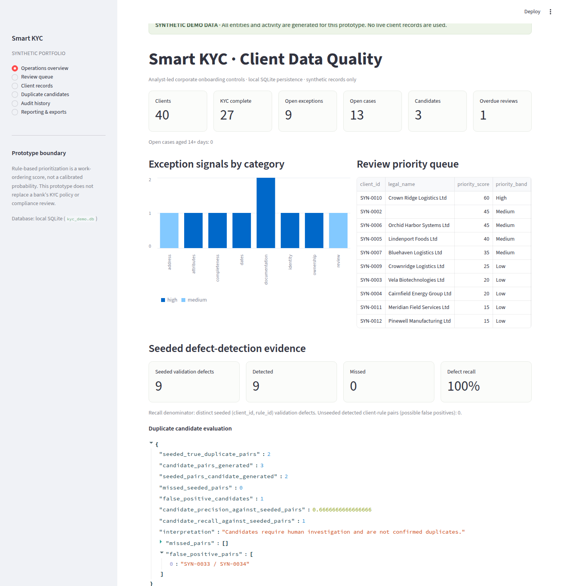
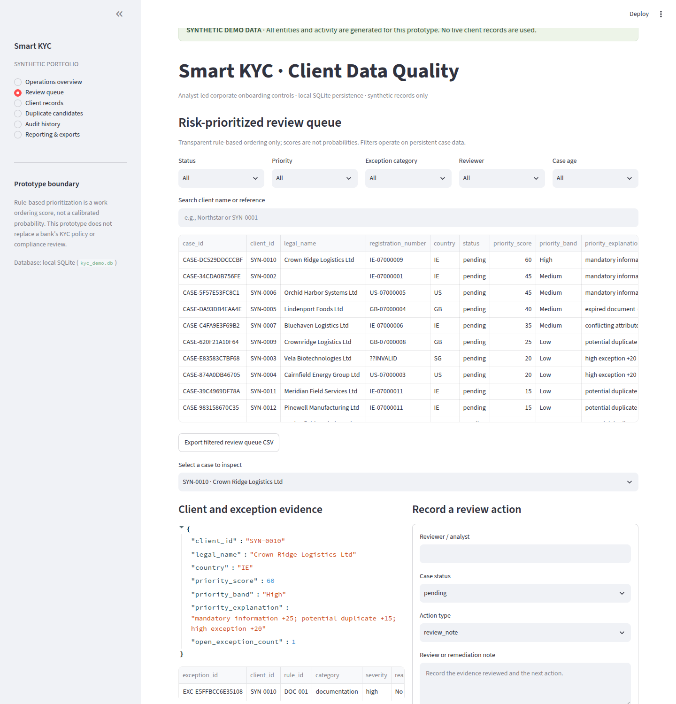
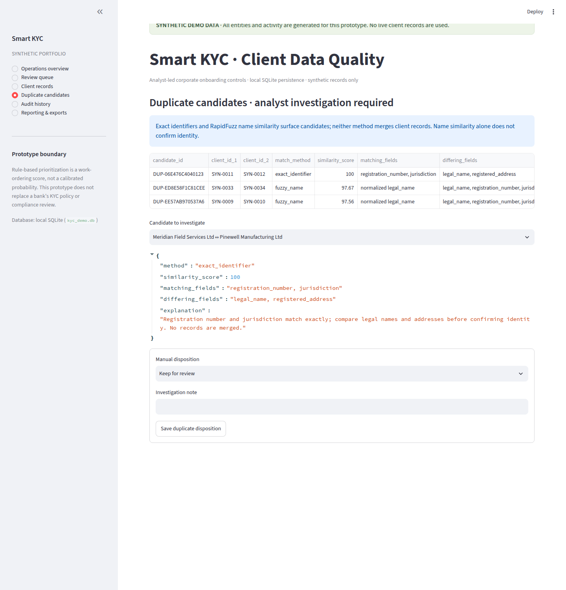

# Smart KYC Onboarding & Client Data Quality Control

A portfolio-ready, local-first corporate KYC data-quality and analyst-review prototype built with Python, Pandas, SQLite, RapidFuzz, Streamlit, pytest, CSV, and XLSX. It generates reproducible synthetic client, beneficial-owner, and document metadata; validates configured rules; surfaces exact and fuzzy duplicate **candidates**; prioritizes analyst work with an explainable score; persists cases and review actions; and creates Power Query/Power BI-compatible reporting data.

> **Synthetic-data boundary:** Every sample client, owner, document reference, finding, and activity in this repository is generated. This prototype is not a bank's formal KYC policy, a regulatory determination, legal advice, an AML decision engine, or a substitute for qualified compliance review. Similar names and matching scores identify candidates for human investigation only; the system never automatically merges clients or confirms identity from name similarity alone.

## Features

- Fixed-seed corporate records with required-field gaps, invalid registration formats, future dates, expired/missing documents, missing ownership, inconsistent attributes, overdue periodic review, exact duplicate identifiers, fuzzy name variants, and legitimate similar-name candidates.
- Configurable mandatory fields, identifier regex, date format, address-component threshold, fuzzy threshold, priority weights, score bands, and case-state transitions in `config/rules.json`.
- Stable exception identifiers and human-readable reason/evidence for every detected rule violation. Source records are not silently rewritten.
- Exact matching on normalized registration number **and** jurisdiction; RapidFuzz matching on normalized names using the maximum of full-string ratio and token-sort ratio. Candidate details include compared fields, differences, score, explanation, and manual disposition.
- SQLite entities and foreign-key relationships for clients, beneficial owners, documents, validation exceptions, duplicate candidates, review cases, review actions, and append-only audit history. Audit triggers reject update/delete operations.
- Streamlit views for operations overview, prioritized queue filtered by status/priority/category/reviewer/age, client search/detail, KYC completeness, exception dispositions, duplicate investigation, audit review, reporting, and filtered CSV/XLSX downloads.
- Rule-based priority with configurable, visible contributions; its score is for work ordering, **not a calibrated probability**.
- CSV exports, a filterable multi-sheet Excel reconciliation workbook, Power Query setup guidance, Power BI fact/dimension CSVs, DAX measures, and dashboard layout specification.

## Screenshots

These are genuine screenshots of the running Streamlit app using synthetic records and actions:







## Requirements and installation

Python 3.11+ is recommended for the tested dependency set. The dependency ranges are in `requirements.txt` and `pyproject.toml`; SQLite is included with Python.

```bash
python3 -m venv .venv
source .venv/bin/activate        # Windows: .venv\Scripts\activate
python -m pip install --upgrade pip
python -m pip install -e '.[test]'
```

To install the declared dependencies without editable packaging, use `python -m pip install -r requirements.txt`, then run commands from the repository root (or install with `python -m pip install -e .`).

## Run the system

Initialize the local database, generate the fixed-seed synthetic portfolio, validate records, identify duplicate candidates, score review work, and persist the initial queue:

```bash
python -m kyc_quality.cli run-demo
```

The default SQLite path is `data/kyc_demo.db`; the local database is git-ignored. An existing database is reconciled idempotently: case status, reviewer actions, exception dispositions, duplicate dispositions, and audit history are not deleted by a subsequent seed run.

Launch the analyst interface:

```bash
streamlit run app/streamlit_app.py
```

Optional environment variables: `KYC_DB_PATH` selects a SQLite file and `KYC_REPORT_DIR` selects the Streamlit export directory.

Other commands (global `--database` must precede the subcommand):

```bash
python -m kyc_quality.cli --database data/kyc_demo.db init-db
python -m kyc_quality.cli --database data/kyc_demo.db validate
python -m kyc_quality.cli --database data/kyc_demo.db detect-duplicates
python -m kyc_quality.cli --database data/kyc_demo.db export --output reports/generated
```

`validate` and `detect-duplicates` run the reproducible demo pipeline and print actual evaluation results. `export` reads an initialized database and writes CSV outputs plus `smart_kyc_reconciliation.xlsx`. `reports/generated/` is ignored; curated, synthetic sample outputs are committed under `reports/sample/`.

## Test

```bash
python -m pytest -q
```

Tests cover each individual validation rule, valid records, deterministic generation, exact and fuzzy matching, legitimate lookalike candidates, priority factors and caps, SQLite relationships and constraints, allowed/rejected status changes, idempotent restarts, audit immutability, CSV/XLSX creation, navigation through every Streamlit view, and persistence of a submitted UI review action.

**Verified release check:** a fresh virtual environment installed successfully with `python -m pip install -e '.[test]'`; `python -m pytest -q` completed with **35 passed** and no warnings. Streamlit AppTest exercised all six views and submitted a review action that was read back from the isolated test database with its audit note. A real Streamlit server returned HTTP 200 on the app and health endpoints.

### Measured seeded evaluation

For the committed 40-client generator with seed `2026`, the evaluation denominator is nine distinct seeded `(client_id, rule_id)` validation defects: **9 detected, 0 missed, 0 unseeded client-rule exceptions, 100% defect-level recall**. This is a controlled fixture result, not production performance or test coverage.

Duplicate evaluation has two seeded true candidate pairs (one exact identifier pair and one fuzzy name variant): both were generated, so **2/2 seeded pairs, 0 missed, 100% seeded-pair candidate recall**. Three total candidate pairs were generated; one is the deliberately legitimate similar-name pair, so **2/3 candidate precision (66.7%) against the seeded true-pair set**. That lookalike remains status `candidate`, not `confirmed_duplicate`. Exact and fuzzy candidate results are never represented as confirmed matches without manual disposition. Full calculated evidence is in `reports/sample/detection_evaluation.json`.

## Architecture and repository map

```text
app/streamlit_app.py                Streamlit analyst screens
config/rules.json                   Configurable validation, match, score, and workflow rules
data/                               Local ignored SQLite database (generated at runtime)
docs/architecture.md                Components and data flow
docs/business_rules.md              Rule catalogue, matching, priority and metrics
docs/data_dictionary.md             Entity and reporting field definitions
excel/power_query_setup.md          Reconciliation workbook and Power Query steps
powerbi/                             Fact/dimension model, DAX, and dashboard guidance
reports/sample/                      Curated synthetic CSV/XLSX outputs and evaluation
scripts/build_sample_reports.py     Rebuild curated sample artifacts reproducibly
sql/schema.sql                      SQLite tables, indexes, views, and append-only triggers
sql/reporting_queries.sql           Operational/reporting SQL examples
src/kyc_quality/                    Data generation, validation, matching, scoring, DB, reports, CLI
tests/                                pytest unit and integration coverage
```

## Data model and case workflow

The normalized SQLite model includes `clients`, `beneficial_owners`, `documents`, `validation_exceptions`, `duplicate_candidates`, `review_cases`, `review_actions`, and `audit_history`. Primary keys, foreign keys, uniqueness, range/status checks, and indexes are in `sql/schema.sql`; `client_completeness` calculates required-field, KYC, owner, document, and open-exception state. Operational queries are in `sql/reporting_queries.sql`.

A review case is created for a client with an exception or duplicate candidate. Permitted transitions are explicit in `config/rules.json`: `pending → in_review|closed`; `in_review → awaiting_information|resolved|closed|pending`; `awaiting_information → in_review|resolved|closed`; `resolved` and `closed` are terminal. Review notes, status changes, assignment, exception resolution, and duplicate dispositions persist to SQLite and append audit events in a transaction. Audit table triggers make history update/delete attempts fail.

## Validation and prioritization

Rules emit stable exception IDs, client and rule IDs, category, severity, a readable reason, evidence reference, detection time, and review status. Rule IDs and intended checks are documented in [Business rules](docs/business_rules.md). Registration numbers use the configurable regex; date inputs use ISO `YYYY-MM-DD`; mandatory fields and address components are configurable; document expiry and periodic-review due dates are compared to the run date.

Priority weights, age thresholds, score cap, and bands are in `config/rules.json`. Scores add configured contributions for missing required data, expired documents, attribute conflicts, potential duplicates, the highest exception severity, and case age, then cap at 100. The interface exposes contribution text for every scored case. It is a queue-ordering aid, not a probability, financial-crime prediction, or client risk rating.

## Excel, Power Query, and Power BI

The export command creates CSVs for client quality, exceptions, duplicate candidates, review queue, case aging, reviewer workload, audit/actions, and Power BI-compatible tables (`dim_client`, `dim_rule`, and fact tables). The XLSX workbook applies header filters, frozen headers, and bounded column widths. Follow [Power Query setup](excel/power_query_setup.md) to connect and reconcile the tables.

Power BI Desktop is not run in this Linux environment; this repository therefore delivers compatible datasets, relationship guidance, DAX measure definitions, and a dashboard layout rather than claiming a native `.pbix` or live integration. See [Power BI model and dashboard specification](powerbi/dashboard_spec.md) and [measures](powerbi/measures.dax) for the remaining manual Desktop steps.

## Limitations and future work

This is a single-user local prototype with synthetic metadata only. It has no authentication or role-based access control, external document storage, live KYC provider integration, production bank policy pack, native Power BI Desktop project, case SLA engine, or multi-user concurrency guarantees. Fuzzy name matching is an investigation aid with known false-positive candidates; thresholds require institution-specific validation. The SQLite audit trigger protects ordinary application writes from updates/deletes but is not tamper-evident against an operator with filesystem/database-owner access. Future work could add policy packs, approval controls, encrypted document storage, migration management, role-based permissions, institution-approved evaluation datasets, and deployment hardening.
